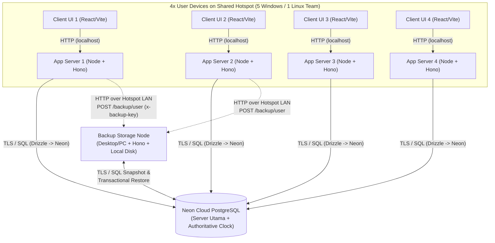
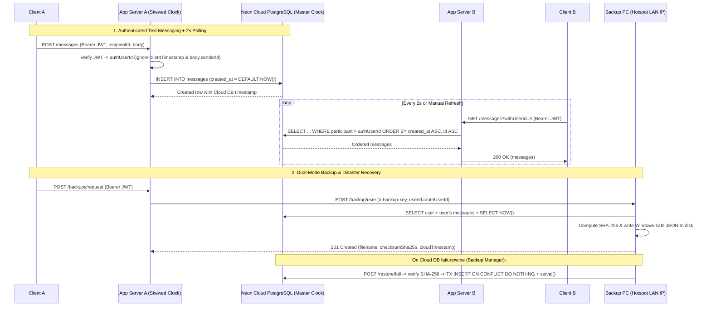

# Project Brief — Distributed Client–Server Messaging System (WhatsApp Architecture Adaptation)

> [!IMPORTANT]
> **Goal Framing:** We are **not** building a consumer WhatsApp clone (no voice/video calls, media CDN, stories, or Signal ratchets). We are implementing **WhatsApp's Client–Server distributed systems architecture** adapted per the *Tugas Sistem Terdistribusi* specification: 4 per-user local Application Servers communicating over **HTTP**, 1 shared **Neon Cloud PostgreSQL** database (primary store + authoritative system clock), strict user data isolation, and 1 dedicated **Desktop/PC Backup Storage** node (no Google Drive).

---

## 1. Project Identity & Hard Boundaries

| Attribute | Final Specification |
| :--- | :--- |
| **Course Deliverable** | *Tugas Sistem Terdistribusi* — Live system presentation only (no code/report submission; *"Tidak dikumpulkan melainkan melakukan presentasi"*) |
| **Deadline** | **30 November 2026** |
| **Team Size & OS Mix** | **6 members** — 5 Windows laptops, 1 Linux machine |
| **Messaging Scope** | **Text messaging only** (no image/file upload or Media Store CDN) |
| **Protocol** | **HTTP** across Client ↔ Local Application Server ↔ Backup Storage PC |
| **Primary Store & Clock** | **1 shared Neon Cloud PostgreSQL** instance (all user/message state + authoritative server clock) |
| **Backup Store** | **1 Desktop/PC Backup Storage** node on a team member's computer (**explicitly NOT Google Drive**) |
| **Auth & Privacy** | Pre-seeded login via `username` or `email` + `password`; strict per-user data isolation (users cannot view, read, or access another user's private data without authorization) |

---

## 2. Finalized Product & Architecture Decisions

All 5 open product decisions are now locked:

| Decision Area | Locked Choice | Concrete Implication for PRD & Implementation |
| :--- | :--- | :--- |
| **1. Backup Trigger Scope** | **Dual Mode** | (a) Any authenticated user can trigger **Backup My Data** (`POST /backups/request` → `POST /backup/user`) saving a snapshot containing only their own account metadata & messages; (b) The Backup Storage Manager can trigger **Full System Snapshot & Disaster Recovery** (`POST /backup/full` and `POST /restore/full`) on the Backup PC. |
| **2. Demo Network Topology** | **Shared Mobile Hotspot** | All 6 laptops connect to one shared mobile hotspot and communicate over **LAN IPs** (no Tailscale or external tunnel). Requires configuring Windows Firewall inbound rule on the Backup PC's port and disabling AP/client isolation if the hotspot enables it. |
| **3. Cloud PostgreSQL Host** | **Neon** | Single shared Neon serverless PostgreSQL database (`DATABASE_URL` with `sslmode=require`). Use Neon's pooled connection endpoint (or small pool `max: 3` per node across 4 App Servers + 1 Backup PC) and document Neon's cold-start wake-up behavior. |
| **4. Client Message Refresh UX** | **2-second HTTP polling + Manual Refresh** | Each Client UI polls `GET /messages?withUserId=...` every 2 seconds over HTTP and includes an explicit **Refresh** button so live updates feel smooth while every HTTP cycle remains visible in DevTools. |
| **5. Account Onboarding** | **Pre-seeded login only** | No interactive self-registration UI. Accounts (e.g., `user1`–`user4`, plus optional admin/demo test user) are provisioned via an idempotent CLI seed script (`npm run db:seed`). `POST /auth/login` accepts either `username` or `email` + `password`. |

---

## 3. Empirical Spike Findings & Locked-In Stack

Before locking the stack, we executed a multi-node spike (`npm run spike` in [run-spike.ts](file:///home/bagasnugroho/.gemini/antigravity/brain/bdb2aef2-1357-4975-a8cc-8a322f4cfb12/scratch/spike/src/run-spike.ts)) running **3 real HTTP servers** (`AppServer-A`, `AppServer-B`, `BackupServer`) against a real PostgreSQL engine (`@electric-sql/pglite` WASM) on **Node.js `v22.22.2`** (`npm 10.9.7`).

### Observed Spike Results

1. **Zero-Build, Zero-Native-Compile Cross-OS Runtime:**
   - `npm install` of `hono@4.13.22`, `@hono/node-server@1.19.19`, `drizzle-orm@0.44.7`, `@electric-sql/pglite@0.3.16`, and `zod@3.25.76` completed in **26,588 ms** (`46 MB` `node_modules`) with **zero `node-gyp` / C++ native builds**.
   - Node `v22.22.2` executed `.ts` files directly via native type-stripping (booting 3 Hono HTTP servers + DB in **3,585 ms**).
   - **Why not `bun` / `pnpm` / `pg_dump` / `docker`:** None of `bun`, `pnpm`, `docker`, or `pg_dump`/`psql` were present on the host, and Bun on Windows carries path/process-spawning edge-case risks. Using **Node.js v22 LTS + `npm`** + **`node:crypto` (`scrypt`)** + **SQL-level JSON/SHA-256 backup & restore** eliminates OS-specific setup failures across 5 Windows + 1 Linux laptops.
2. **Windows-Safe Backup Filenames:**
   - Raw ISO timestamps (`2026-11-26T20:06:13.209Z`) contain `:` which is **illegal in Windows filenames**. The spike verified filename sanitization (`2026-11-26T20-06-13-209Z`) via [filenames.ts](file:///home/bagasnugroho/.gemini/antigravity/brain/bdb2aef2-1357-4975-a8cc-8a322f4cfb12/scratch/spike/src/lib/filenames.ts) and `node:path.join`.
3. **Cloud-Clock Authority Under Severe Node Skew:**
   - With `AppServer-A` skewed `+2h`, `AppServer-B` skewed `-3h` (5-hour clock divergence), and forged `clientTimestamp` values (`1999` and `2099`), PostgreSQL `TIMESTAMPTZ DEFAULT NOW()` stamped and ordered all messages strictly by Cloud DB time (`[msg-1, msg-2, msg-3]`).
4. **Auth & IDOR Isolation:**
   - Negative HTTP tests verified `401 Unauthorized` for missing tokens/backup keys, `403 Forbidden` for cross-user conversation reads, `senderId` spoofing, and cross-user backup requests.
5. **Idempotent Backup, Restore & Sequence Continuity:**
   - User-scoped backup (`950 bytes`) exported only Alice's 3 messages with **0** leakage of Bob↔Charlie messages.
   - Full backup (`1,994 bytes`, `15 ms`) → simulated DB wipe (`TRUNCATE ... RESTART IDENTITY CASCADE`) → full restore (`49 ms`, `3 users, 4 messages`) → second restore (`0` duplicates) → post-restore login & new message insert succeeded at **`id = 5`** (because restore explicitly ran `setval(pg_get_serial_sequence(...))`).
   - Tampered backup file was rejected with **`HTTP 422`** SHA-256 checksum mismatch.

> [!NOTE]
> **First Check in the New Workspace:** The spike validated all SQL/Drizzle logic against local `PGlite` WASM. Once Neon is provisioned, run a **2-minute live Neon + Hotspot smoke test** verifying: (a) `DATABASE_URL` TLS connectivity + `SELECT NOW()` latency from Node `postgres`/`pg` driver, (b) 5 concurrent connections (4 App Servers + 1 Backup PC), and (c) HTTP reachability from a Windows laptop to the Backup PC over the shared mobile hotspot.

### Locked-In Tech Stack

| Component (PDF §2) | Count | Technology |
| :--- | :---: | :--- |
| **Client UI** | 4 users | **React + Vite + Tailwind CSS** (lightweight SPA, 2s HTTP polling + manual refresh) |
| **Local Application Server** | 4 nodes | **Node.js v22 LTS + TypeScript + Hono (`@hono/node-server`) + `hono/jwt` + `zod` + Drizzle ORM** |
| **Cloud Database (`Server utama`)** | 1 | **Neon Cloud PostgreSQL** (`sslmode=require`, `pg` or `postgres` driver) |
| **Backup Storage (`Modifikasi`)** | 1 PC | **Node.js v22 LTS + Hono (`@hono/node-server`) + `node:fs/promises` + SHA-256 JSON snapshots** |

---

## 4. System Architecture & Explicit HTTP Trust Boundaries

### Core HTTP Flows

### Explicit Trust Boundaries

| Boundary | Trusted To | Must NEVER Trust |
| :--- | :--- | :--- |
| **Client UI → Local App Server** | Render UI, store user's JWT in session/memory, poll `localhost:<port>` every 2s over HTTP. | Never trusted for `senderId`, `userId`, `createdAt` timestamps, or direct DB access. |
| **Local App Server (×4)** | Verify JWT (`hono/jwt`), enforce `authUserId` on all reads/writes/backups, verify `scrypt` password hashes. | Never trusts `req.body.senderId`, `req.query.asUserId`, `clientTimestamp`, or its own OS clock (`Date.now()`). |
| **Neon Cloud PostgreSQL** | Store canonical `users`, `messages`, `backup_logs`; generate `TIMESTAMPTZ DEFAULT NOW()` for all events. | Never exposed directly to Client UIs; only App Servers & Backup PC hold `DATABASE_URL`. |
| **Backup Storage PC** | Authenticate callers via `x-backup-key`, write SHA-256-signed snapshots to local disk, verify checksum before restore. | Never accepts unauthenticated requests (`401`/`403`), path traversal filenames, or unverified/tampered JSON (`422`). |

---

## 5. Core Distributed-Systems Invariants

1. **Cloud-Clock Single Source of Truth:** All `created_at` columns use PostgreSQL `TIMESTAMPTZ NOT NULL DEFAULT NOW()`. Conversations are ordered by `ORDER BY created_at ASC, id ASC`. Local OS clocks on the 6 laptops are never used for message ordering or backup timestamps.
2. **Strict Auth & Anti-IDOR Isolation:** Passwords use `node:crypto` `scryptSync` + 16-byte random salt + `timingSafeEqual`. Every protected endpoint derives identity strictly from the verified JWT `sub` claim and rejects cross-user reads, spoofed `senderId`, or cross-user backup triggers with `HTTP 403`.
3. **Dual-Mode, Idempotent, Integrity-Checked Backup & Recovery:**
   - User-requested backups (`/backups/request` → `/backup/user`) export only the authenticated requester's user metadata and messages (zero leakage of other users' private chats).
   - Full-system backups (`/backup/full`) and restores (`/restore/full`) are reserved for the Backup Storage Manager.
   - Every snapshot includes a `checksumSha256` over `{ cloudTimestamp, data }`; corrupted/tampered files fail with `HTTP 422` before touching Neon.
   - Restore runs inside a single PostgreSQL transaction using `ON CONFLICT (id) DO NOTHING` (safe to re-run) followed by `setval(pg_get_serial_sequence(...))` so post-restore inserts never collide on primary keys.
   - All snapshot filenames strip Windows-forbidden characters (`[<>:"/\\|?*]`) and resolve via `node:path.join`.
4. **Cross-OS Team Parity:** Repo enforces `.gitattributes` (`* text=auto eol=lf`), `.env.example`, and `npm` scripts only.

---

## 6. 6-Person Role Ownership & Live Presentation Runbook

### Team Role Mapping (PDF §3 — 6-Person Group)

| PDF Role | Headcount | Primary Ownership |
| :--- | :---: | :--- |
| **Client/User + Application Server** | **4 members** | Run own local React+Vite Client & Node+Hono App Server on 4 separate laptops; own pre-seeded login UI, text chat UI (2s polling + manual refresh), message APIs, and IDOR/isolation tests. |
| **Pengelola Cloud Database** | **1 member** | Provision & manage **Neon** Cloud PostgreSQL, Drizzle schema/migrations, `db:seed` pre-seeded accounts, `DATABASE_URL` distribution, and live DB table inspection/wipe during demo. |
| **Pengelola Backup Storage** | **1 member** | Run Backup PC HTTP service on Desktop/PC over hotspot LAN IP, manage Windows/Linux firewall rule & local disk snapshot directory, SHA-256 verification, and full-DB disaster recovery endpoints/CLI or admin UI. |

### 5-Scene Live Presentation Runbook
1. **Scene 1 — Multi-Node Distributed Messaging (Shared Hotspot):** 4 laptops each run their own Client + local App Server over HTTP. User 1 logs in with pre-seeded credentials and sends a text message to User 2; User 2 receives it automatically within 2 seconds (or via manual Refresh) from Neon.
2. **Scene 2 — Cloud-Clock Time Sync Proof:** Show `/health` on two laptops with differing OS clocks; send alternating messages and show Neon Cloud DB timestamps governing exact conversation order.
3. **Scene 3 — Privacy & Anti-IDOR Proof:** Demonstrate via HTTP (`curl` / DevTools) that User 3 attempting to read User 1↔User 2's conversation, spoof `senderId`, or request User 1's backup receives `HTTP 403 Forbidden`.
4. **Scene 4 — User-Requested Backup to Desktop/PC:** User 1 clicks **"Backup My Data"**. Open the Backup Manager's local disk folder live to show the newly created Windows-safe JSON snapshot (and inspect it to show it contains only User 1's messages).
5. **Scene 5 — Simulated Cloud DB Failure & Idempotent Restore:** Cloud DB Manager runs the wipe/truncate command on Neon (showing chat history gone / login failing). Backup Manager triggers `POST /restore/full` from the full Desktop/PC snapshot → Neon repopulates → User 1 logs back in, sees all messages intact, and sends a new message seamlessly.

---

## 7. 1-to-1 Requirements Traceability Matrix (PDF §1–§5)

| PDF Requirement | System Component | Role Owner | Spike / Readiness Status | Live Demo Proof |
| :--- | :--- | :--- | :--- | :--- |
| Adapt WhatsApp Client–Server architecture (§1, §4) | 4× Client + 4× App Server + 1× Neon DB + 1× Backup PC | All 6 | Verified | Architecture diagram + 6-node live run |
| Client/User per device over HTTP (§2a, §4) | React+Vite SPA (2s polling + refresh) → local Hono HTTP API | 4× Client+Server | Verified (API); UI to build | 4 laptops running separate `localhost` servers |
| Local Application Server per user (XAMPP/Laragon or other) (§2b, §4) | Node.js v22 + Hono `@hono/node-server` | 4× Client+Server | Verified (`3585ms` boot) | 4 independent server terminals/logs |
| One shared Cloud Database (§2c, §4) | Neon Cloud PostgreSQL (`sslmode=require`) | 1× Cloud DB Mgr | Local PG verified; Neon TLS smoke test next | Shared `DATABASE_URL` + Neon Console |
| Cloud server clock as time-sync reference (§2c, §4) | PostgreSQL `TIMESTAMPTZ DEFAULT NOW()` | 1× Cloud DB Mgr | Verified (+2h/-3h skew) | Scene 2 ordering proof |
| Desktop/PC Backup Storage, no Google Drive (§2d, §4) | Hono Backup Service + `node:fs` local disk | 1× Backup Mgr | Verified (`15ms` full) | Local folder inspection on Backup PC |
| Backup on user request & recovery on DB failure (§2d, §4) | Dual-mode: `/backups/request` → `/backup/user` & `/backup/full` + `/restore/full` | Backup Mgr + App Server | Verified (`49ms` restore, idempotent) | Scene 4 & Scene 5 wipe + restore |
| Login with username/email + password (§4) | Pre-seeded `db:seed` + `POST /auth/login` (`scrypt` + JWT) | 4× Client+Server + DB Mgr | Verified | Login with username & email |
| Strict private data isolation & no unauthorized access (§4) | JWT `sub` enforcement + `401`/`403` guards | 4× Client+Server | Verified (5 negative tests) | Scene 3 `403 Forbidden` demo |
| 6-person role division (§3) | 4 Client+Server, 1 Cloud DB, 1 Backup PC | All 6 | Mapped | Each member presents their node |
| Nov 30, 2026 live presentation (§5) | 5-Scene Demo Runbook (Shared Hotspot) | All 6 | Scripted | Live presentation |
